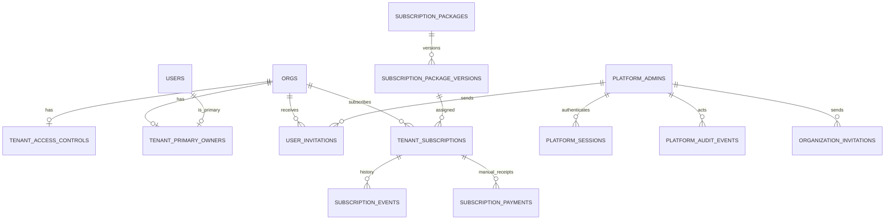

# Elite ERP Platform Owner — Data Model & Schema Specification
## Stage 2 · Additive PostgreSQL / Drizzle proposal

**Version:** 1.0 · **Date:** 2026-11-06 · **Status:** **Proposed schema; NOT executed SQL or a migration approval.**  
**Baseline inspected:** `Delowar01/Elite-ERP` at `83e8093`, where `orgs.id` and `users.id` are integer keys and `users.orgId` is mandatory; user email is globally unique; customer roles are `owner`, `admin`, `staff`.  
**Cross-reference:** `PRD.md` definitions; `appflow.md` state machines; `TRD.md` service/guard contracts.

## 1. Data design principles

1. Do **not** mutate or re-key existing `orgs`, `users`, finance, invoice, stock, audit or security tables for convenience. New platform objects link to the real tenant organization by its existing integer ID.
2. **Separate platform identity** from tenant `users`. Never create a platform admin with fake `orgId`, and never add a tenant `platform_owner` role.
3. Store **one-way hashes** of tokens/session IDs, never raw invitation links or session tokens. Passwords use existing safe hash conventions; MFA seeds use field encryption.
4. For financial-like subscription values use `numeric(14,2)` (not JS floating point), currency fixed `SAR` in this release. No customer ERP ledger entries.
5. Store event timestamps `timestamptz` in UTC; subscription start/end as `date` in a fixed platform timezone (initially `Asia/Riyadh`).
6. Use immutable version/snapshot records. Do not let package edits rewrite existing subscriptions.
7. Make event/audit/payment history append-only and strongly linked to operator identity. No tenant-delete cascade into commercial evidence.
8. Invitations are pending metadata records, **not** phantom orgs/users with placeholder passwords.
9. Enforce race-sensitive uniqueness and last-owner/subscription boundaries in both the database and transactional service layer.
10. This is an **illustrative relational specification**; Claude must inspect the live DB, Drizzle migrations and existing FK/index names before authoring SQL.

## 2. Entity relationship summary

Existing `orgs` and `users` are unchanged baseline tables in this diagram. An `organization_invitations` record is independent until accepted and then stores `accepted_org_id`.

## 3. Core platform schema

### 3.1 `platform_admins`

| Column | Type | Constraint / meaning |
|---|---|---|
| `id` | `uuid` | PK, server generated |
| `email_normalized` | `text` | Required, unique lowercase email |
| `display_name` | `text` | Required |
| `password_hash` | `text` | Required, no plaintext storage |
| `is_active` | `boolean` | Required, default true |
| `mfa_secret_encrypted` | `text` | Required **before any authenticated platform session** |
| `mfa_recovery_hashes` | `jsonb` | Hashes only; single-use, rotation enforced |
| `mfa_enrolled_at` | `timestamptz` | Required to permit login |
| `password_changed_at` | `timestamptz` | Required |
| `last_login_at` | `timestamptz` | Nullable |
| `created_at`, `updated_at` | `timestamptz` | Audited metadata |

**Indexes:** unique `lower(email_normalized)` (normalized before write), active-operator lookup. **No `org_id`.** Initially exactly one operational account by bootstrap policy, not by hardcoding user ID.

### 3.2 `platform_sessions`

| Column | Type | Constraint / meaning |
|---|---|---|
| `id` | `uuid` | PK |
| `platform_admin_id` | `uuid` | FK `platform_admins.id`, restrict deletion |
| `token_hash` | `text` | Required unique SHA-256 of opaque `jti` |
| `mfa_verified_at` | `timestamptz` | Must be non-null on active sessions |
| `created_at`, `last_seen_at` | `timestamptz` | Required |
| `expires_at` | `timestamptz` | Required |
| `revoked_at`, `revoked_reason` | `timestamptz`, `text` | Nullable; invalidation record |
| `ip_address`, `user_agent` | `text` | Nullable; privacy-limited retention |

**Indexes:** `(platform_admin_id, revoked_at, expires_at)`, unique `token_hash`. No database or API should return hashes to the browser.

### 3.3 `platform_login_attempts`

`id uuid PK`, `email_hash text`, `ip_hash text`, `attempted_at timestamptz`, `outcome text`, `blocked_until timestamptz NULL`. Indexed by email/IP hash and time. Retain only bounded period; do not log plaintext submitted passwords or TOTP. Supports privileged **durable** login throttling without introducing an external paid service.

### 3.4 `platform_audit_events`

| Column | Type | Constraint / meaning |
|---|---|---|
| `id` | `bigserial` | PK; append-only |
| `actor_platform_admin_id` | `uuid` | Nullable FK for system/anonymous events; restrict operator deletion |
| `actor_label` | `text` | Display snapshot |
| `action` | `text` | Required code e.g. `company.suspended`, `payment.recorded` |
| `entity_type`, `entity_id` | `text`, `text` | Required references; accommodate UUID/integer IDs |
| `org_id` | `integer` | Nullable FK existing `orgs` (on delete restrict) |
| `reason` | `text` | Required for restricted actions |
| `before_safe`, `after_safe` | `jsonb` | Redacted state snapshots, no secrets |
| `result` | `text` | `success` / `rejected` / `failed` |
| `request_id` | `uuid` | Correlation/idempotency link |
| `ip_address`, `user_agent` | `text` | Nullable |
| `created_at` | `timestamptz` | Required UTC |

**Indexes:** `(org_id, created_at DESC)`, `(actor_platform_admin_id, created_at DESC)`, `(action, created_at DESC)`, unique or indexed request correlation as suitable. Database `BEFORE UPDATE OR DELETE` **reject** trigger, verified in tests; no update/delete API. Operator export itself is an audit event.

## 4. Company and ownership controls

### 4.1 `tenant_access_controls`

`org_id integer PK FK -> orgs.id`, `access_status text NOT NULL CHECK (access_status IN ('active','suspended'))`, `reason text NULL`, `changed_by_platform_admin_id uuid FK`, `changed_at timestamptz`, `created_at timestamptz`, `updated_at timestamptz`.

- Missing row for a **pre-existing legacy organization** maps to active only through the explicitly audited compatibility function; don't infer suspended/expired from billing.
- A newly accepted organization must receive a row atomically.
- Only platform actions can change status. On suspend, revoke tenant `sessions` rows for the matching `org_id` in the same critical section/transaction; session checks must reject suspended orgs even if a session was overlooked.
- Do not cascade-delete tenant data or permit any Platform Owner tenant deletion UI.

### 4.2 `tenant_primary_owners`

`org_id integer PK FK -> orgs.id`, `user_id integer NOT NULL FK -> users.id`, `assigned_at timestamptz NOT NULL`, `assigned_by_platform_admin_id uuid NULL FK`.

**Invariant:** primary user is `is_active=true` and `users.org_id = tenant_primary_owners.org_id`, with `role='owner'`. Enforce tenant match through composite `(org_id,user_id)` FK when practical (requires additive unique key on existing `users(org_id,id)`), otherwise a validated DB trigger and service-level locked check; a simple single-column FK **alone is insufficient**. A migration audit must flag any existing company with no active owner or multiple candidates. Do not auto-pick an ambiguous owner. Role/mapping transfer is atomic.

## 5. Invitations

### 5.1 `organization_invitations`

| Column | Type | Constraint / meaning |
|---|---|---|
| `id` | `uuid` | PK; display as `INV-…` |
| `company_name`, `industry`, `company_email` | `text` | Required name/email; industry optional |
| `country_name`, `currency_code` | `text` | Explicit country and currency; validate with existing ERP catalog |
| `owner_name`, `owner_email_normalized` | `text` | Required |
| `initial_package_version_id` | `uuid` | FK `subscription_package_versions.id` |
| `initial_cycle` | `text` | Trial / monthly / annual, compatible with version |
| `token_hash` | `text` | Required unique; never expose in queries |
| `expires_at` | `timestamptz` | Required; default 72h |
| `accepted_at`, `revoked_at` | `timestamptz` | Nullable; mutually exclusive terminal states |
| `accepted_org_id` | `integer` | Nullable FK `orgs.id`, unique when set |
| `invited_by_platform_admin_id` | `uuid` | Required FK |
| `created_at` | `timestamptz` | Required |

**Lifecycle:** pending → accepted OR revoked OR expired (expired derived from time); reissue revokes previous and inserts new token row. Enforce one current usable invite per normalized owner email in service logic/transaction. Never create real org until acceptance.

### 5.2 `user_invitations`

`id uuid PK`, `org_id integer NOT NULL FK -> orgs.id`, `name text NOT NULL`, `email_normalized text NOT NULL`, `requested_role text CHECK IN ('admin','staff')`, `token_hash text UNIQUE NOT NULL`, `expires_at timestamptz NOT NULL`, `accepted_at timestamptz NULL`, `revoked_at timestamptz NULL`, `accepted_user_id integer NULL FK -> users.id`, `invited_by_platform_admin_id uuid FK`, `created_at timestamptz`.

**Indexes:** `(org_id, email_normalized)` for pending search, `(org_id, expires_at)`, unique token hash. Accept only once within the company; check existing globally unique `users.email`, tenant access, seat availability and status under transaction. Reissue revokes old token.

## 6. Commercial package catalog

### 6.1 `subscription_packages`

`id uuid PK`, `code text NOT NULL UNIQUE` (stable slug), `name text NOT NULL UNIQUE` (case-folded catalog name), `description text NULL`, `status text CHECK IN ('draft','active','archived')`, `is_trial boolean DEFAULT false`, `is_default_trial boolean DEFAULT false`, `created_by_platform_admin_id uuid FK`, `created_at timestamptz`, `updated_at timestamptz`.

**Constraints:** at most one `is_default_trial=true`; canonical Trial cannot be archived. `archived` excludes *new assignment* but keeps past references. Package name and description can change without rewriting financial snapshots.

### 6.2 `subscription_package_versions`

| Column | Type | Constraint / meaning |
|---|---|---|
| `id` | `uuid` | PK |
| `package_id` | `uuid` | FK -> `subscription_packages.id` |
| `version_number` | `integer` | Required >0; UNIQUE `(package_id, version_number)` |
| `publish_state` | `text` | `draft` / `published` |
| `currency_code` | `char(3)` | Must be `SAR` in Stage 2 |
| `monthly_price`, `annual_price` | `numeric(14,2)` | Required ≥0 |
| `included_seats` | `integer` | Required >=1 |
| `storage_allowance_gb` | `integer` | Required >=1; **not technically enforced** |
| `module_groups` | `jsonb` | Validated array of selected existing ERP groups; **not technically enforced** |
| `trial_days` | `integer` | Trial version 1–120; other versions 0 |
| `published_at` | `timestamptz` | Nullable in draft |
| `created_at`, `created_by_platform_admin_id` | timestamp/uuid | Audit provenance |

**Immutability:** published financial/allowance fields cannot be updated or deleted; new changes create next version. Prefer a DB trigger plus service policy. No silent re-assignment of existing tenants. Draft can be edited before publish. Plan prices from the HTML (SAR 149/349/799 etc.) are **fictional placeholders only**.

## 7. Subscriptions and events

### 7.1 `tenant_subscriptions`

| Column | Type | Constraint / meaning |
|---|---|---|
| `id` | `uuid` | PK |
| `org_id` | `integer` | FK existing `orgs.id`, RESTRICT delete |
| `package_version_id` | `uuid` | FK published package version |
| `cycle` | `text` | `trial` / `monthly` / `annual` |
| `lifecycle_state` | `text` | `trialing` / `active` / `paused` / `cancelled` |
| `start_date`, `end_date` | `date` | Required; end >= start; platform business timezone |
| `superseded_at` | `timestamptz` | Null for current; set for historical assignments |
| `price_snapshot_sar` | `numeric(14,2)` | Exact cycle price at assignment; Trial = 0 |
| `seats_snapshot` | `integer` | >0; actual seat guard limit |
| `storage_snapshot_gb` | `integer` | >0; display only |
| `module_groups_snapshot` | `jsonb` | Display only |
| `manual_note` | `text` | Optional, platform private |
| `created_by_platform_admin_id` | `uuid` | FK |
| `created_at`, `updated_at` | `timestamptz` | Required |

**Indexes:** UNIQUE `(org_id) WHERE superseded_at IS NULL` (one current record per org), `(end_date, lifecycle_state)` for alerts, `(package_version_id, superseded_at)` for assignment checks.

**Interpretation:** `expired` is **derived** if `end_date < platform_today` for a non-superseded record; do not persist an independently drifting `expired` state. Subscription status does not set `tenant_access_controls.access_status`. Payment receipts do not set `lifecycle_state` automatically. When changing packages, supersede current and insert next in one transaction. Renewal may update `end_date` on current row while adding an immutable event.

### 7.2 `subscription_events`

`id bigserial PK`, `tenant_subscription_id uuid FK`, `org_id integer FK`, `event_type text` (`assigned`, `renewed`, `paused`, `resumed`, `superseded`, `cancelled`, `terms_updated`), `actor_platform_admin_id uuid FK`, `before_safe jsonb`, `after_safe jsonb`, `reason text`, `request_id uuid`, `created_at timestamptz`.

**Policy:** append-only; store relevant before/after and preserve revisions. Unique `(tenant_subscription_id, request_id, event_type)` where appropriate to make retries idempotent.

## 8. Manual subscription payments

### 8.1 `subscription_payments`

| Column | Type | Constraint / meaning |
|---|---|---|
| `id` | `uuid` | PK |
| `tenant_subscription_id` | `uuid` | FK actual subscription |
| `org_id` | `integer` | FK existing org; verify matches subscription |
| `entry_type` | `text` | `receipt` / `reversal` |
| `amount_sar` | `numeric(14,2)` | Receipt >0; reversal amount negative and equals original amount magnitude |
| `payment_date` | `date` | Required |
| `external_reference` | `text` | Non-empty for receipts, normalized; uniqueness per org for receipts |
| `cycle_label` | `text` | Monthly / annual / other, informational |
| `note` | `text` | Optional |
| `reverses_payment_id` | `uuid` | Nullable self-FK, required for reversal; UNIQUE non-null |
| `request_id` | `uuid` | Required UNIQUE idempotency key |
| `created_by_platform_admin_id` | `uuid` | Required FK |
| `created_at` | `timestamptz` | Required |

**Rules:** immutable rows; reversal is a **new** row with negative amount linked to one receipt, no deletion. Use service check for same org/subscription and accurate reversal. `UNIQUE (org_id, lower(external_reference)) WHERE entry_type='receipt'` (or another approved payment-reference scheme) prevents duplicate imported references. **Never** insert into existing tenant ERP `payments`, journals, invoices or VAT tables.

## 9. Singleton settings

### `platform_settings`

| Column | Type | Default |
|---|---|---|
| `id` | `smallint PK CHECK (id = 1)` | 1 |
| `default_trial_days` | `integer CHECK 1..120` | 14 |
| `grace_days` | `integer CHECK 0..60` | 0, alerts only |
| `invite_only` | `boolean` | true, **locked in Stage 2** |
| `expiry_alerts_enabled` | `boolean` | true |
| `manual_billing` | `boolean` | true, **locked in Stage 2** |
| `platform_mfa_required` | `boolean` | true, **locked in Stage 2** |
| `platform_currency` | `char(3)` | `SAR`, locked |
| `platform_timezone` | `text` | `Asia/Riyadh` |
| `updated_by_platform_admin_id` | `uuid` | Nullable FK |
| `updated_at` | `timestamptz` | Required |

Security-critical booleans must be validated on backend as immutable true for the initial release, regardless of how a UI toggle behaves. Current subscriptions/invitations are **not** retroactively altered by default changes.

## 10. Existing schema touchpoints and migration risk

| Existing model/code | Stage 2 integration | Protection |
|---|---|---|
| `orgs` | Read tenant-safe metadata; existing org ID is external PK target; optional metadata ownership review. | Do not overwrite country/currency/tax/branding if tenant-controlled. |
| `users` | Reuse tenant users, roles, `isActive`, last-login, MFA; may add composite uniqueness `(org_id,id)` if needed for ownership FK. | Global email uniqueness and session invalidation preserved. |
| `sessions` | Revoke all org sessions on suspension; user sessions on role/status/owner transfer. | Existing customer session logic remains valid; no platform cookies accepted. |
| `src/lib/session.ts` | Enforce new access-control gate for logged-in tenant. | Guard must cover all protected pages/actions/exports. |
| Existing `/register` | Make invitation-only at approved cutover; reuse registration/seed transaction. | No orphan tenants; grandfather valid users. |
| Current `audit_logs` | Leave tenant business audit intact. | Platform actions go to separate `platform_audit_events`. |
| ACC-01 / financial tables | **No schema/content changes.** | Full accounting regression remains green. |

## 11. Migration sequence and backfill

1. **PO-00 read-only baseline**: list current tables, FKs, indexes, triggers and owner-role anomalies. Confirm backup strategy and design branch state.
2. Create new platform tables and indexes on an **isolated test database**. Re-run `drizzle` schema parity and current ERP regression suites.
3. Create controlled bootstrap Platform Owner with MFA. Do not put credentials in migration or CI logs.
4. Backfill `tenant_primary_owners` only for orgs with exactly **one valid active owner**. Report ambiguous cases for manual, authorized decision; do not select arbitrarily.
5. `tenant_access_controls`: support compatibility resolution of absent legacy row as active. Optionally backfill active rows transactionally after reporting; no retroactive suspension.
6. Initialize catalog with approved—not demo—prices. If prices are not approved, keep commercial versions as unpublished drafts; do not create paid subscriptions for existing tenants automatically.
7. Existing organizations remain in **grandfathered active access**, with no subscription assigned unless explicitly approved. Do not force them onto a billable plan.
8. Apply customer-access and seat-guard integration only after full tests on controlled test DB. Invite-only toggle is last, at cutover.
9. Production `db:push`/migration and release are **separately authorized operations** with pre/post backup, rollback and smoke tests. No silent VPS/Neon changes.

## 12. Consistency, retention and threat cases

- Deny FK cascade deleting a tenant if it would erase subscription or audit evidence; tenant deletion is out of scope. The current ERP has `users.org_id ON DELETE CASCADE`: Stage 2 operations must never trigger org deletion.
- Race test simultaneous double-click invitation acceptance and manual payment receipt, same-org concurrent subscription assignments, and two ownership transfers.
- Prevent malformed JSONB module groups, invalid decimal precision, negative date range, zero seats, cross-organization primary owner and reversed receipt twice.
- Audit and payment events must reject UPDATE and DELETE at DB layer after hardening; ensure permissions cannot disable triggers in normal app runtime.
- Do not store payment card PAN, bank authentication, raw invitation tokens, password resets or customer uploaded files in platform tables.
- Run actual migration dry-run and restore verification before signing off; this document alone makes no claim that existing schema has these tables or constraints.
