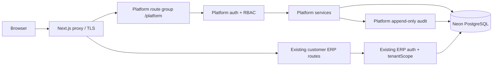

# Elite ERP Platform Owner — Technical Requirements Document (TRD)
## Stage 2 · Architecture, security, integrations, APIs, performance and QA

**Version:** 1.0 · **Date:** 2026-11-06 · **Status:** Architecture proposal for gated implementation.  
**Existing reference snapshot:** `Delowar01/Elite-ERP` `main` at `83e8093276b36320754972f845c38f23fd28fa61` (ACC-01). A separate LCP visual migration branch `feat/erp-lcp-design-system` was present at planning time; recheck source HEAD before work.  
**Use with:** `PRD.md`, `appflow.md`, `UI_spec.md`, `Schema.md`, `Plan.md`.

## 1. Current-system facts verified in repository

| Existing component | Verified behavior / impact |
|---|---|
| Next.js App Router + React + TypeScript + Tailwind 4 | Extend within existing deployment; no separate SaaS product/service. |
| Drizzle ORM + Neon PostgreSQL | Additive schema and migrations only after DB preflight and backup. |
| `src/db/schema/orgs.ts` | `orgs` holds tenant identity, currency, country, settings. No reviewed platform owner/subscription fields. |
| `src/db/schema/users.ts` | Each user has one non-null `orgId`; email is globally unique; role `owner` / `admin` / `staff`; `isActive`, MFA and last-login fields exist. |
| `src/lib/auth.ts` | Customer session JWT includes `userId` + `orgId`; production `__Host-elite_erp_session`. |
| `src/lib/session.ts` | Customer session lookup checks server-side revocation and joins user to org; it currently checks `user.isActive`, not the proposed tenant suspension. |
| `src/lib/security/session-store.ts` | Session rows and revocation helpers exist for customer accounts. |
| `src/app/(auth)/actions.ts` | Existing registration transaction creates org, owner, seeds defaults; `/register` publicly reachable in baseline. |
| `src/lib/tenant.ts` | Tenant queries must use `tenantScope(orgId, table)` and session-derived orgId. |
| `src/db/schema/security.ts` | Existing append-only tenant audit and security events; separate platform audit advisable. |
| `src/proxy.ts` | Next.js proxy currently treats standard customer login/register as auth routes, JWT check for protected paths; must branch safely for platform paths. |
| Hostinger / systemd + Neon | Preserve unrelated applications, active ERP release, backup/rollback and exact SHA deployment. |

**Source-of-truth rule:** this is based on the reviewed baseline, **not** a claim that the concurrent Claude redesign has merged. At implementation start, inspect current `main`, branches, migrations, route tree and tests again. Do not overwrite in-flight visual conversion or assume new tokens are already deployed.

## 2. Target system overview



**Deployment:** same Next.js process/service, same Postgres database; dedicated platform route group, server services, tables and cookie. Server-side operations must never rely on hiding navigation alone. No new external billing service and no mandatory separate worker/Redis service for the initial release.

### 2.1 Suggested code boundaries (verify paths after LCP branch)

```text
src/app/(platform)/platform/login/page.tsx
src/app/(platform)/platform/layout.tsx
src/app/(platform)/platform/dashboard/page.tsx
src/app/(platform)/platform/companies/page.tsx
src/app/(platform)/platform/companies/[orgId]/page.tsx
src/app/(platform)/platform/users/page.tsx
src/app/(platform)/platform/subscribers/page.tsx
src/app/(platform)/platform/packages/page.tsx
src/app/(platform)/platform/activity/page.tsx
src/app/(platform)/platform/settings/page.tsx
src/app/(platform)/platform/recover/page.tsx
src/app/(platform)/platform/actions/*
src/lib/platform/auth.ts
src/lib/platform/session.ts
src/lib/platform/guards.ts
src/lib/platform/companies.ts
src/lib/platform/invitations.ts
src/lib/platform/users.ts
src/lib/platform/packages.ts
src/lib/platform/subscriptions.ts
src/lib/platform/payments.ts
src/lib/platform/audit.ts
src/lib/platform/metrics.ts
src/lib/platform/seats.ts
src/db/schema/platform.ts
src/components/platform/*
verify/verify-platform-*.mts
```

Logical paths are **illustrative**, not existing files. Next.js route groups do not change URL path. Build platform UI from the final approved ERP/LCP design adapter and shared primitives; keep customer navigation isolated.

## 3. Authentication, authorization and tenancy

### 3.1 Platform identity

- Create **separate** `platform_admins`, `platform_sessions` and `platform_audit_events` tables, not fake `users` records with `orgId=0` or `role=platform_owner` in the tenant role enum.
- Bootstrap first Platform Owner through an explicit one-time, audited operational command; use password hash and out-of-band MFA enrollment. No source-controlled credentials and no public signup.
- Use an independent production cookie, for example `__Host-elite_erp_platform`, with `HttpOnly; Secure; SameSite=Lax; Path=/; no Domain`, independent session `jti` hashed in DB, expiry and revocation. Prefer a **separate signing secret** (`PLATFORM_AUTH_SECRET`) with secret rotation runbook; never reuse customer `AUTH_SECRET` as a trust shortcut.
- Mandatory TOTP or single-use recovery code for every platform login. Recovery codes hashed/rotated; TOTP secret field-encrypted. Rate-limit username/IP using a durable store or DB-backed table/service appropriate to single-VPS deployment; avoid relying on purely in-process counts for privileged auth.
- `requirePlatformSession()` checks signature, claims type `platform`, server-side session, active admin, MFA-authenticated state; `requirePlatformPermission()` can be a one-role allowlist now and expand later. No tenant `requireRole('owner')` can grant platform access.
- Platform session expiry: conservative **12-hour maximum absolute lifetime** and 30-minute inactivity timeout (candidate security defaults; verify with owner/security review before release). MFA recovery, password change, admin disable and logout-all revoke sessions.

### 3.2 Proxy/routing boundary

- Explicitly allow `/platform/login` and the restricted recovery route to load without a platform cookie; enforce platform auth for the other `/platform/*` routes.
- Existing customer routes continue to validate customer token, not platform token. The two cookies may coexist but **never** authorize one another.
- Proxy may do an edge-safe signature check; every server-side page, action and export must call the platform guard with server-side revocation and authorization. Avoid redirect loops when a cookie is stale.
- Treat rejected/unauthorized access as indistinguishable from non-existing tenant targets where appropriate; do not expose names via error messages.

### 3.3 Tenant isolation and privacy

- Platform services may query only allowlisted `orgs` metadata, `users` identity/role/status/last login, platform invitation/subscription/package records, and safe event summaries. Deny arbitrary SQL/table browsing and customer accounting/HR/documents.
- Preserve current ERP `tenantScope()` for **all existing tenant tables**; do not add a global bypass or impersonation to the existing session.
- Any platform action accepting `orgId` validates it, applies operation-specific permissions, and uses a transaction to update narrowly scoped rows.
- Email normalization uses lowercase trim and existing global uniqueness. Users remain single-organization; no cross-company transfer/membership.

## 4. Organization access integration

**Storage:** `tenant_access_controls` keyed by existing `orgs.id`, with status `active` / `suspended`, actor and reason. No need to rewrite every `orgs` row in the first migration; missing rows for historic tenants resolve to **active** only in the specifically audited compatibility path. Invalid access state fails closed.

**Mandatory integration:** update customer `getSession()` (or a shared central authorization check used by all pages/server actions) to deny suspended organizations. Update customer `loginAction`, session issuance, protected file routes, exports and print access to honor the same check. For suspension, atomically change status and revoke **every** session associated with that org; public share links and signed URLs require a separate threat-model check because they may outlive an authenticated browser session. No data deletion. Do not change business posting functions.

**Checks:** suspension with a live browser and a race against concurrent server action; denial through direct POST/API requests, downloads, PDFs and any public endpoints not intended to remain accessible; reactivation and new sign-in.

## 5. Onboarding and invitations

- Add distinct `organization_invitations` and `user_invitations`. Raw invitation tokens are **never stored**, only a cryptographic hash, and are displayed once to the operator. Secure random generation, 72-hour default expiry, single-use redemption, revoke/resend invalidation.
- Organization invitation payload holds the minimal necessary company/owner metadata and intended initial package version. **No `orgs` row until successful acceptance**.
- Acceptance runs inside one DB transaction: validate/lock invitation, verify global unique owner email, create `orgs`, create owner `users`, seed defaults using existing logic, populate `tenant_primary_owners`, `tenant_access_controls` and initial `tenant_subscriptions`, mark accepted, audit.
- Password generated only by recipient; never emailed as plaintext or visible to platform operator.
- User acceptance validates active tenant, email uniqueness, package seat capacity and role, then creates existing user, marks invite accepted and logs event. Resend invalidates prior token.
- Public `/register` must be gated by an explicit invite-only policy before SaaS launch, without breaking existing active organizations and test/admin recovery. Copy-link invitation delivery is allowed; email provider integration is later.

## 6. User controls and seat capacity

- `platform/users` actions may change `users.role` and `users.isActive` only via guarded, audited transactions; revoke affected sessions immediately. Cross-company ownership transfer is forbidden.
- Store one canonical `tenant_primary_owners` mapping per org. On initial migration, run a **read-only** audit to detect orgs with zero/multiple owner-role users; select/repair only through an owner-approved controlled migration process. Do not choose an owner arbitrarily.
- Ownership transfer locks mapping and both users, validates same `orgId` and active target, updates roles, mapping, revokes sessions and writes audit in a single transaction. Prevent last primary owner demotion or disable.
- **Seat cap enforcement:** use one shared `assertUserSeatAvailable(orgId, tx)` service covering platform invites and **all existing tenant-side user creation/invite paths**. Lock the current subscription/organization for concurrency, count `users` (including disabled) plus unexpired/pending invitations; no seat freed by disabling. Companies already above their new seat cap are grandfathered but cannot add more until plan upgrade or count falls through an approved safe offboarding mechanism. If existing user-creation paths cannot be safely covered, the go-live gate fails; do not display false “enforced” badges.
- Storage GB and included module groups are versioned catalog metadata only and **not** enforced in Stage 2.

## 7. Packages, subscriptions and manual billing

### 7.1 Package versions

- Package identity (`subscription_packages`) is mutable for display name/archive state; published commercial terms live in append-only `subscription_package_versions` with monotonically increasing `version`.
- All active/new assignments reference an exact published version and snapshot commercial fields. In-place modification of a published price/seat/feature version is prohibited.
- Trial default cannot be archived. Archive is blocked while current non-superseded assignments exist; history remains readable.
- Catalog currency fixed to **SAR** at Stage 2. Customer base currency may differ (AED, BDT, etc.) but that does not convert the platform billing amount; no speculative FX calculations.

### 7.2 Subscription semantics

- One **current** subscription per actual org (`superseded_at IS NULL`); historical rows retained. Assignment or plan switch supersedes the old current record transactionally.
- Canonical lifecycle: `trialing`, `active`, `paused`, `cancelled` with `expired` as a **derived view state** when `end_date` is before the current platform business date. Paid **plan assignment** is not proof of collected payment.
- Renewal changes subscription end date and appends an event; payment entry is independent. Pausing does not suspend org access. Trial remains trialing until a paid package is assigned.
- Subscription dates are business **date** fields interpreted in configured `Asia/Riyadh` platform timezone; store event timestamps in UTC. Renew from `max(current end date, today)` to avoid losing remaining days.
- 20-day expiring-soon window in dashboard (initial default), grace-days used for reminders only; never auto-suspend or delete an org on expiry.

### 7.3 Manual payment semantics

- Record independent platform subscription payment with amount `numeric(14,2)` SAR, effective date, external reference, operator and request ID. Validate strictly positive amount for receipts (negative amount only for explicit linked reversal entries), duplicates, and current subscription reference.
- Double-click/retry is idempotent; unique external reference per org where provided. Corrections use separately audited void/reversal **record**, never silently rewrite history.
- **No writes to existing customer ERP journal, invoices, VAT, payments or financial reports.** Manual payment evidence is not platform tax invoicing.

## 8. Server actions and logical interfaces

Implementation may use Next.js Server Actions in existing conventions rather than introducing public REST APIs. Every mutation needs input schema validation, rate/authorization checks, transaction where appropriate, idempotency, structured result and audit.

| Service / action (logical names) | Request | Result / required guard |
|---|---|---|
| `getPlatformDashboard` | Date range | Aggregated metadata; platform session. |
| `listCompanies` | Query/status/plan/country/page | Pagination, no customer business fields. |
| `createOrganizationInvite` | Company + owner + initial package | One-time token return; no org created yet. |
| `acceptOrganizationInvite` | Token + password | Atomic org+owner+seed+subscription. Public token endpoint with strict validation. |
| `updateCompanyMetadata` | orgId + platform-managed fields | Safe fields only, audit. |
| `setCompanyAccess` | orgId + active/suspended + reason + idempotency | Revoke sessions, audit and access guard. |
| `listCustomerUsers` | orgId/role/status/query | Safe identity metadata. |
| `createUserInvite` / `acceptUserInvite` | orgId, email, role / token, password | Seat check, unique email, single-use token. |
| `setUserStatus` / `setUserRole` | userId + new value + reason | Protect primary owner; revoke sessions. |
| `transferPrimaryOwner` | orgId + targetUserId + reason | Row-lock, atomic transfer, invalidate sessions. |
| `createPackage` / `publishPackageVersion` | Catalog + version payload | Validate SAR prices/allowances; immutable published terms. |
| `archivePackage` | packageId + reason | Guard current assignments / trial default. |
| `assignSubscription` | orgId, packageVersionId, cycle, start/end | One current assignment; history snapshot. |
| `extendSubscription` / `pauseSubscription` | id, duration/state, reason | Timestamp consistency, audit; access unaffected. |
| `recordManualPayment` | subscriptionId, SAR amount, date, reference, requestKey | One payment record, no ERP posting. |
| `exportPlatformMetadataCsv` | Entity/filter/page/requestKey | Allowlisted fields, audit, safe filename/content. |

Avoid destructive GETs. Logs must not include raw token links/passwords/MFA codes. All data-changing operations send an opaque request key for idempotency where retries matter.

## 9. Database, indexes, auditing and migration strategy

Detailed physical proposal is in `Schema.md`. Add platform-specific tables/indexes with stable FK links to `orgs` and `users`; use `numeric` for money and UTC timestamps/date-only terms; enforce current subscription uniqueness; immutable audit and package versions; avoid `ON DELETE CASCADE` from tenant core into financial history. Separate audit principals so platform actor IDs do not masquerade as tenant `users.id`.

**Migration order:** inventory DB → read-only preflight and data/owner anomalies → backup/restore evidence → additive schema in isolated test DB → backfill `tenant_primary_owners` only from unambiguous single owner → add read-through guards/compatibility → enable invite-only policy after smoke tests → production migration under independent approval → deploy and test. Any ambiguous legacy owner/active-package state is a blocking report, not a guessed automated correction.

## 10. Error handling, performance and observability

- Typed errors: `UNAUTHORIZED`, `FORBIDDEN`, `NOT_FOUND`, `COMPANY_SUSPENDED`, `INVITE_EXPIRED`, `INVITE_USED`, `EMAIL_CONFLICT`, `SEAT_LIMIT`, `LAST_PRIMARY_OWNER`, `SUBSCRIPTION_CONFLICT`, `DUPLICATE_PAYMENT`, `VERSION_CONFLICT`, `VALIDATION_FAILED`.
- Do not leak account existence in unauthenticated password endpoints; human-readable bilingual messages for authorized operator forms.
- Paginate companies/users/subscriptions/activity on server; filter/sort with indexes; avoid N+1 queries for counts and owner emails. Limit CSV rows and stream for bigger exports if needed.
- Basic p95 goal at 1,000 synthetic orgs: list response under 2.5 seconds; measure rather than claim performance. Rate-limit login, invitations, exports, critical mutations.
- Readiness and error logging should exclude PII/secrets. Track failed platform logins, invitation redemption, suspension outcomes, owner transfers, renewals and payment idempotency with correlation IDs.
- Backup includes actual database plus uploaded files/storage separately per existing infrastructure; verify restore drill in isolated environment. Controlled application rollback cannot blindly roll back an additive schema that newer code already uses.

## 11. Test and release gates

**Automated:** typecheck, lint, Next production build, current ERP static/server/browser suites, ACC-01 finance regression, migration dry runs against both empty and populated isolated databases; platform-specific security/role/isolation tests, concurrent operations, audit-immutability and package-version tests.  
**Browser:** 7 pages, login/MFA, all dialogs and drawers, light/dark, full EN/AR RTL, 1440/1280/1024/820/390/360 viewports; no clipped actions; actual keyboard/focus/contrast.  
**Adversarial:** tenant token used as platform token, platform token used as tenant token, cross-org IDs, stale sessions after suspension, duplicate invite acceptance, expired token, concurrent owner transfers, duplicate payment and CSV formula injection.  
**Operational:** exact commit/PR CI green, migration backup, restore, rollback/feature disable, no impact to other hosted services, test-only preview, owner sign-off before every production-facing action.

## 12. Change-control restrictions

No editing, merging, deploying or resetting anything in the real ERP is authorized by these documents. Existing `feat/erp-lcp-design-system` visual conversion is separately controlled: do not mix Platform Owner business schema/auth changes into that UI-only branch. A new dedicated Platform Owner branch is based on a fresh reviewed baseline **after** the design change is approved/merged (or is rebased carefully with separate review). Preserve ACC-01 accounting, source data, existing print output and live hosted applications. Customer feature flag/rollout must default off until all integration gates pass.
