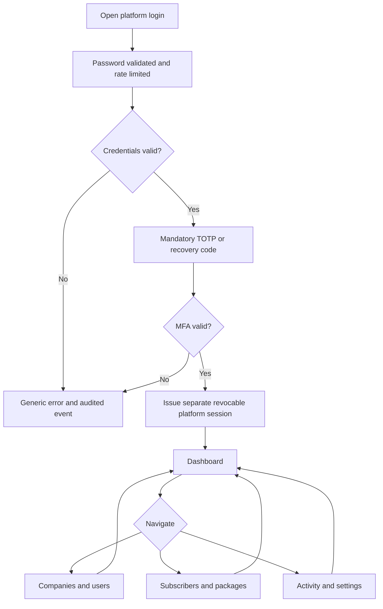
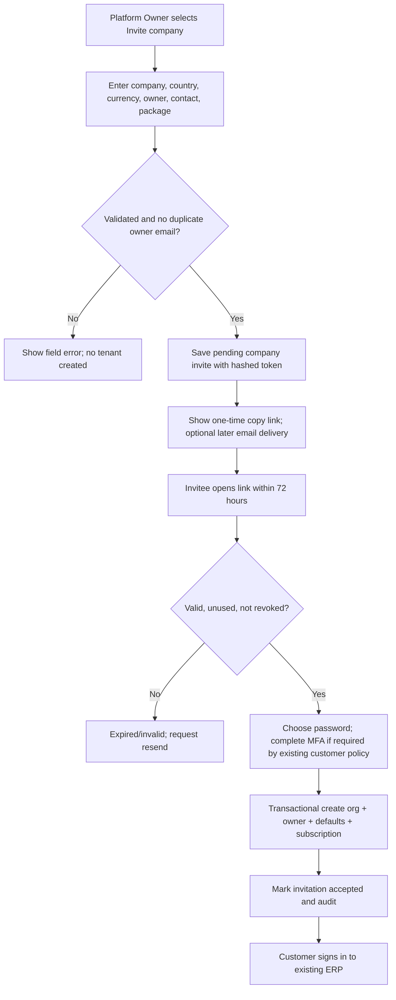
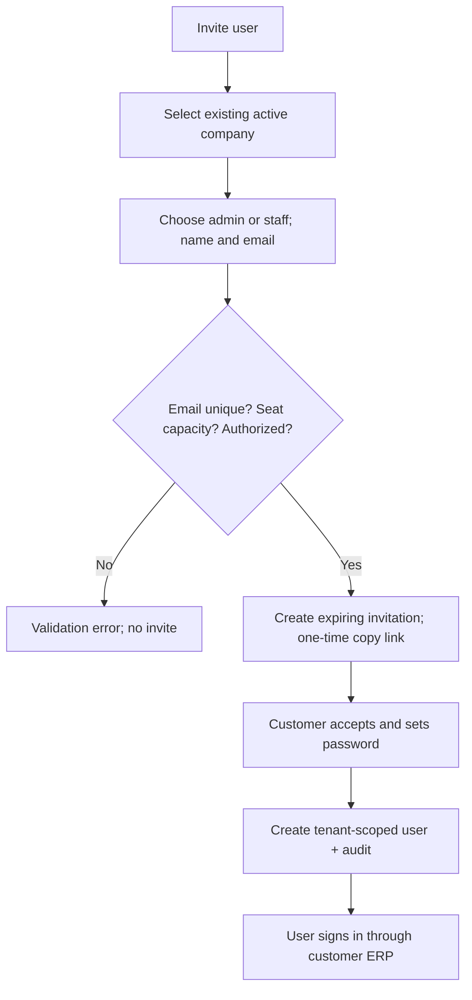
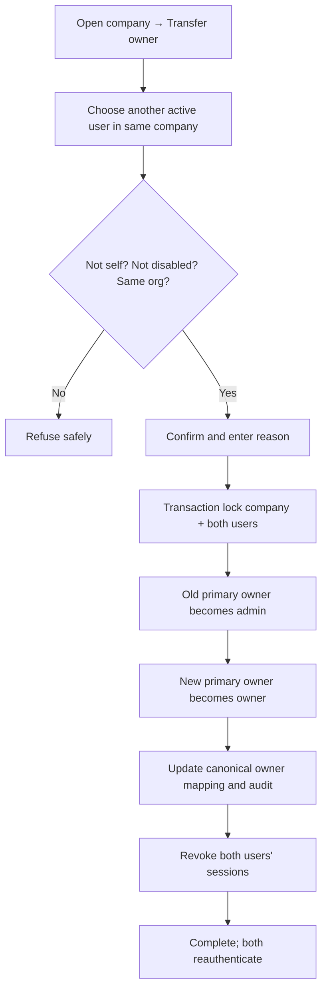
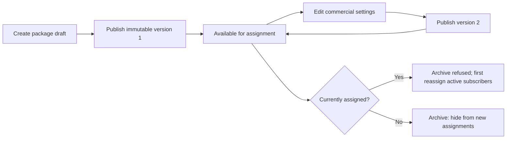
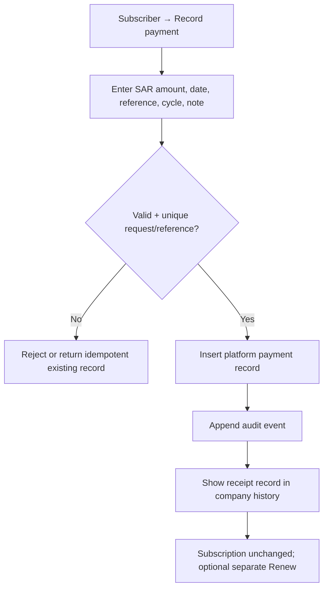

# Elite ERP Platform Owner — Application Flows
## Stage 2: Navigation, actors, workflows, state transitions and exceptions

**Version:** 1.0 · **Date:** 2026-11-06 · **Status:** Planning baseline, not deployed  
**Based on:** Stage 2 interactive HTML concept; production-safe behavior is detailed below.  
**Cross-reference:** `PRD.md` defines scope; `TRD.md` enforces auth and transactions; `Schema.md` defines persistence.

## 1. Navigation map

```text
/                                  Existing customer ERP entry (unchanged)
/platform/login                    Separate Platform Owner login + MFA
/platform                         Redirect to /platform/dashboard
/platform/dashboard               KPIs, registrations, mix, expiring companies
/platform/companies               Companies and pending company invitations
/platform/companies/[orgId]       Company workspace; drawer or page (same fields)
/platform/users                   Customer user directory + pending invitations
/platform/subscribers             Assigned subscriptions, payments, renewals
/platform/packages                Package catalog + package version management
/platform/activity                Immutable operator-event history
/platform/settings                Defaults + operator security
/platform/recover                 Restricted MFA recovery / account recovery
```

Mobile uses the same routes; navigation switches to a categorized drawer, not a separate mobile application. The detail view may use a drawer on desktop and a full-height sheet on mobile. Deep links must be direct-loadable after an authorized login.

## 2. Roles and access matrix

| Operation | Platform Owner | Company owner | Company admin/staff | Unauthenticated |
|---|---:|---:|---:|---:|
| View Platform dashboard and metadata | Yes | No | No | No |
| Create company invitations | Yes | No | No | No |
| Suspend/reactivate company | Yes, reason | No | No | No |
| View/invite/disable customer users | Yes, scoped UI, audited | Existing tenant app permissions only | Existing tenant app permissions only | No |
| Transfer customer primary owner | Yes, reason + verification | Existing ERP feature if separately supported; otherwise no | No | No |
| Manage packages and subscriptions | Yes | No | No | No |
| Record manual platform payment | Yes | No | No | No |
| View customer invoices/HR/files/GL | **No** | Own tenant role rules | Own tenant role rules | No |
| Login as or impersonate customer | **No** | N/A | N/A | No |
| Platform Owner password and MFA | Own account only | No | No | No |

## 3. Global user journey



**Global rules:** a customer ERP session is never a Platform Owner session. Every page and action requires `requirePlatformSession`; a valid cookie alone is insufficient without a live server-side session row. Every critical state change is logged even if it fails after validation (without storing secrets). A rejected account sees no partial tenant metadata.

## 4. Company invitation and registration flow



**Important:** the pending invitation is NOT a row in `orgs`. The Companies screen displays invited organizations through a combined listing, with an invitation reference distinct from a real `orgId`. Do not seed an empty customer ledger when an email is merely invited. On acceptance, reuse the existing registration/default-seeding service after refactoring it safely; do not implement a second inconsistent org bootstrap path.

**Invite details:** company name, industry, company email, country, deliberately selected base currency, owner name/email, initial active package version or trial policy. If an invite is resent, invalidate the old token; no hardcoded registration credentials. The live self-register `/register` route is **invite-only at production cutover**, with legacy/test-mode policy audited before changing it. Company invitation acceptance is atomic and retry-safe.

## 5. Companies — list and company workspace

1. Open **Companies**; search name/email/industry/owner; filter access, country, package; use server pagination and metadata-only CSV export.
2. Select a company: open its five-tab workspace.
3. **Overview:** real org ID, country, non-editable base currency, contact, primary owner, created date, notes, access and subscription statuses.
4. **Access & controls:** activate/suspend with a required reason; display read-only account metadata and safe last-auth timestamp.
5. **Users:** see active/disabled users and pending invitations; invite staff/admin; open user detail.
6. **Subscription:** current package/version, dates, state, cycle, payments and renewal controls.
7. **Activity:** operator actions on this company with timestamps and actor.

**Company edit rule:** only platform-owned contact/industry/internal-note metadata can be directly edited. Tenant legal details, posted currency, VAT registration, tax ID, business document settings and financial balances stay tenant-controlled. Where the prototype exposes a shared name/country field, implementation must decide per-field ownership; do not overwrite data merely because it appears in the mockup.

### 5.1 Company access state machine

| From | Action | To | Backend effects |
|---|---|---|---|
| No org | Invitation created | `invited` *view-only invite state* | Save pending invitation; no org or session exists. |
| Invited | Invite accepted | `active` actual tenant | Create org; record active access; start subscription. |
| Active | Suspend with reason | Suspended | Transactionally set access, revoke **all** tenant sessions; block future authentication and protected paths. |
| Suspended | Reactivate with reason | Active | Set access; require fresh customer login. No data restoration needed. |
| Any | Delete | Not available | Tenant deletion prohibited in Stage 2. |

**Explicit separation:** suspension can coexist with a paid subscription; expiry can coexist with active access. The UI shows both fields. New company invitation cannot be suspended as if it were a live tenant; it can be revoked/rescheduled.

## 6. Users — invitation, role and session flows

### 6.1 Add existing-company user



- `users.email` is globally unique in the current ERP, so the same address cannot join a second company in this release.
- Pending invitation and active users are separate data types; the directory combines them safely.
- Seat guard counts active + disabled accounts according to the **approved billing rule**, plus unexpired pending invitations to prevent overbooking. Stage 2 rule: count existing users (active/disabled) plus unexpired invitations, except revoked/accepted invites; do not free a seat by disabling a user. Enforcement must be shared with **all** existing tenant user-creation endpoints. Existing tenants above cap are grandfathered for login/use but cannot invite more users until within capacity.

### 6.2 Disable/enable or revoke sessions

1. Open user detail and choose action.
2. Require reason and confirm identity/tenant.
3. Lock user/session records, update status or revoke sessions.
4. Commit security event and immutable platform audit.
5. Existing token immediately fails server-side validation; UI shows success only after commit.
6. Re-enabling requires a **new login**, not restoration of revoked sessions.

**Safety:** primary owner cannot be disabled/demoted while still primary. Platform operator cannot read/reset a user's current password or MFA secrets. MFA reset is intentionally deferred to a separately approved recovery workflow.

### 6.3 Transfer primary owner



If anything fails before commit, neither role nor ownership changes. The implementation must reconcile the prototype's `company.owner` field with actual ERP `users.role` and the absence of an existing primary-owner column.

## 7. Package lifecycle



- Package fields: name, description, monthly/annual SAR price, seats, storage GB, included module groups, trial days if applicable.
- Duplicate creates an independent package (not a shallow alias), initially unpublished until validated.
- Existing subscription retains `package_version_id`, currency, price and seat snapshot after new versions are published. Only explicit re-assignment moves a tenant to a newer version.
- Trial default cannot be archived. Negative prices, nonpositive seat/storage, missing name/features and duplicate catalog codes are rejected.
- “Module groups” and “Storage” are catalog descriptors only; they do not block customer routes or uploads in Stage 2.

## 8. Subscriber / subscription flows

### 8.1 Assign/change package

1. Choose company with completed registration.
2. Choose active package and published version; preview per-period SAR rate, current seats and target allowance.
3. Choose Trial, Monthly or Annual; choose date range, optional reason and payment note.
4. Server verifies package/cycle, no overlapping current subscription, and subscription/seat consistency.
5. Transaction supersedes prior current subscription (if any), creates current assignment + snapshot and writes history.
6. The customer retains access until explicitly suspended; package change does not edit tenant accounting.

### 8.2 Renew/extend

- Presets 14, 30, 90 and 365 days (or authorized explicit date).
- `new_end = max(existing_end, current UTC date) + selected duration` with business date converted consistently to UTC (time-zone rules specified in `TRD.md`).
- Renewal **does not** record a payment. Operator must use Record Payment separately if payment occurred.
- A trial remains a trial unless explicitly converted to paid package/cycle.

### 8.3 Pause/resume and expiry

| Subscription condition | Display | Tenant ERP access |
|---|---|---|
| Trial with future end | Trial | Unchanged; governed only by company access. |
| Paid assignment with future end | Active paid plan | Unchanged. Does not prove collection. |
| End date passed | Expired | Unchanged until operator manually suspends. |
| Explicit pause | Paused | Unchanged until operator manually suspends. |
| Subscription superseded | Historical | Not current; retained in history. |

A default 20-day expiration alert appears in the dashboard; a configurable grace-days field affects notification classification only, **not** access. The prototype labels some paid states `paid`; production should use “Active plan” to avoid claiming money was collected without payment evidence.

### 8.4 Record manual payment



There is **no** platform invoice generator or direct bank reconciliation. Never write to the tenant's `journal_entries` or customer `payments` tables.

## 9. Activity Log and export flow

- Activity filters: date range, actor, entity, company, category, result. Default newest first. Search on approved metadata, not full confidential payloads.
- The event table is append-only; no platform UI to edit/delete audit entries.
- CSV export requires a platform session, explicit request, server-side allowlisted columns, pagination/row limits and a corresponding audit event. Export metadata only.
- No raw invite token, hashed password/MFA, private financial document, uploaded file or customer business records may enter exports.

## 10. Global edge cases and recovery

| Edge case | Expected behavior |
|---|---|
| Invite used twice / simultaneous requests | One acceptance; subsequent attempt safely reports already used. |
| Invite expired or revoked | No account created; owner may reissue; old token invalid. |
| Suspended company user still has browser tab | Every server action denies; session revoked; client redirected to approved access-denied screen. |
| Operator disables last primary owner | Refused; transfer first. |
| Package edited while a company is subscribed | Snapshot unchanged until explicit reassign. |
| Duplicate bank reference / double-click | Idempotent request or validation error; one payment record. |
| Expired subscription without suspension | Access remains active, visible flagged as expired. |
| Platform account logs out during modal | Action rejected, no partial update. |
| Partial transaction failure | Rollback; no orphan company/user/subscription or half-transfer. |
| Business time differs from UTC | Store UTC timestamps and explicit date-only subscription boundaries; never use browser timezone to determine renewal. |
| RTL / mobile | Same routes and actions, logically mirrored layout, controlled internal table scrolling and accessible sheets. |

## 11. Acceptance flows (must be demonstrated end-to-end)

F-01 Platform login + MFA + logout + revoke; F-02 tenant login blocked from platform; F-03 organization invite + copy link + accept; F-04 expired and replayed invite refused; F-05 company suspend while user online + reactivate; F-06 invite admin + staff and honor seats; F-07 role change + disabled user + session revoke; F-08 owner transfer with concurrent attempts; F-09 package create, publish, edit version, duplicate, archive; F-10 subscription assignment, trial-to-paid transition, renewal, pause, expiry; F-11 record manual payment without renewal or tenant accounting; F-12 accurate dashboard counts and audit+CSV; F-13 English/Arabic and light/dark across desktop/mobile; F-14 existing customer ERP financial, import/export and session smoke tests remain green.
